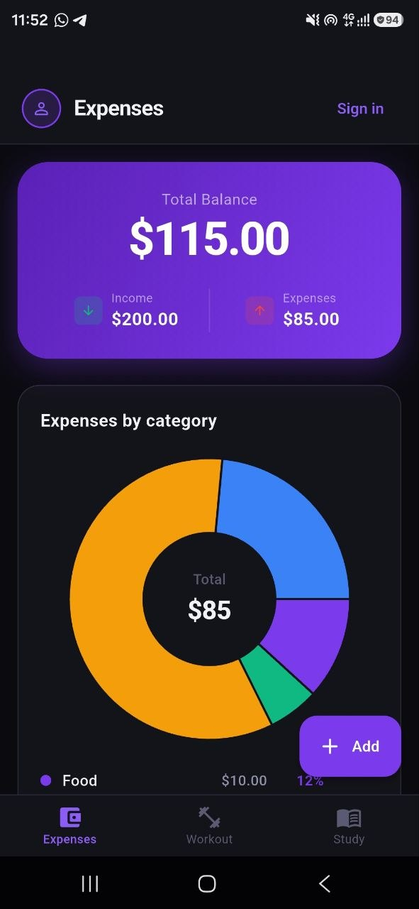
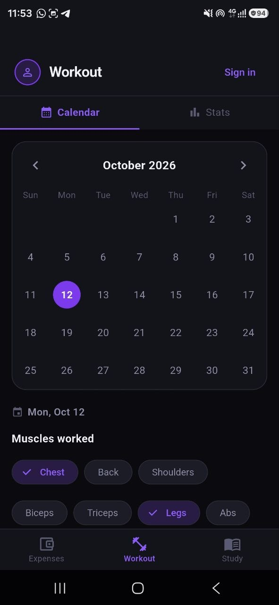
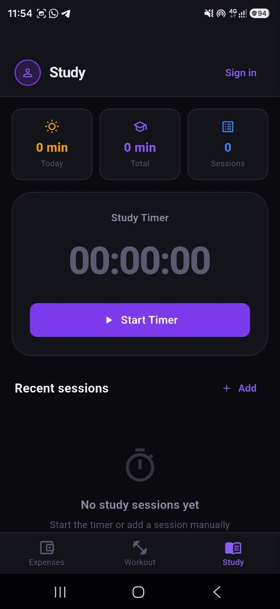
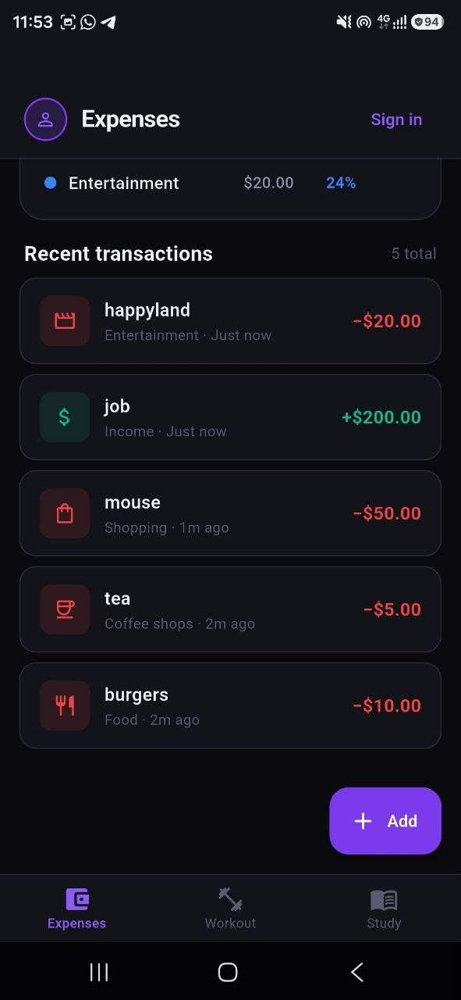
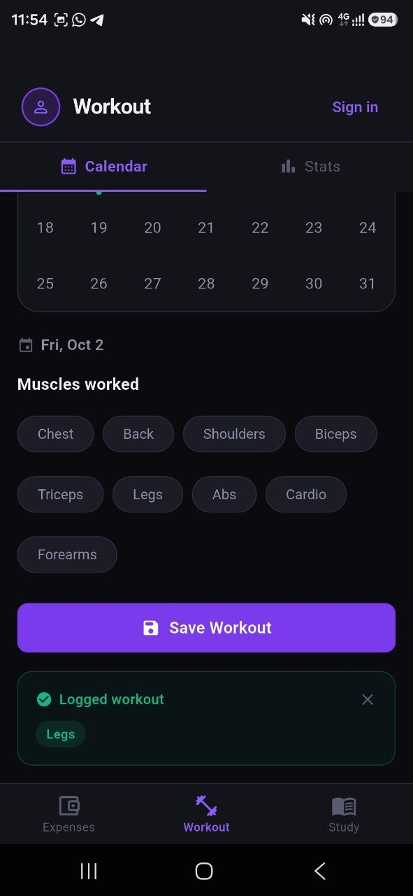
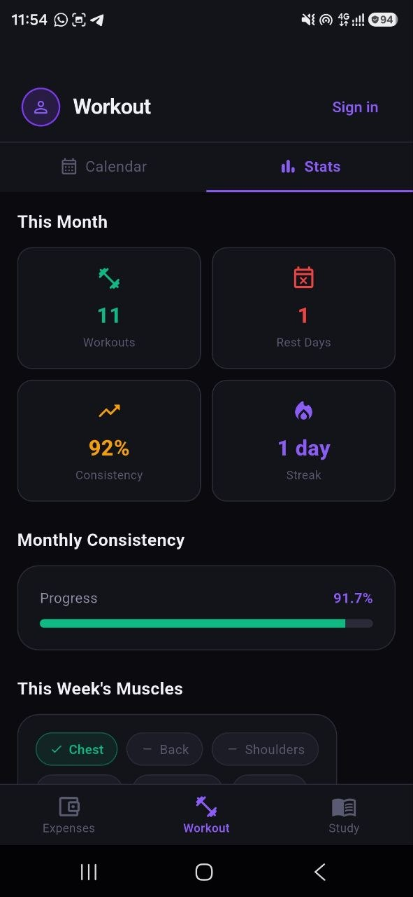
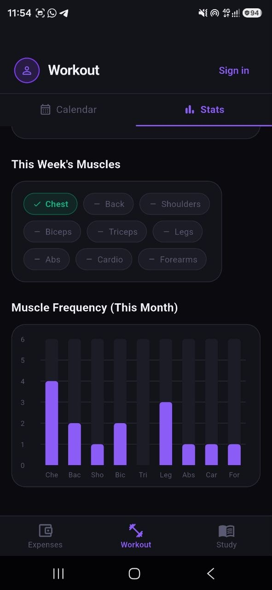

<div align="center">


# Life Tracker

**One app to track your money, your workouts, and your study time.**


</div>

---

## Table of Contents

- [About](#about)
- [Features](#features)
- [Screenshots](#screenshots)
- [Tech Stack](#tech-stack)
- [Architecture](#architecture)
- [Getting Started](#getting-started)
    - [Supabase Setup](#supabase-setup)
    - [Configuration](#configuration)
    - [Installation](#installation)
- [Project Structure](#project-structure)
- [Roadmap](#roadmap)
- [Contributing](#contributing)
- [License](#license)
- [Author](#author)

---

## About

Life Tracker is a Flutter app that brings three everyday habits into one place: **spending**, **exercise**, and **studying**. Instead of juggling separate apps, you log everything in one app and see how each area of your life is going at a glance.

The app is built with **Flutter**, uses **GetX** for state management, routing, and dependency injection, and relies on **Supabase** for authentication and as its backend.

---

## Features

### Authentication
- Sign up and log in securely with **Supabase Auth**.
- Your data is tied to your account, so it stays private and available whenever you sign in.

### Expenses
- Record your expenses with an amount, category, and date.
- View an interactive **pie chart** that shows how your spending is split across categories.
- See at a glance where most of your money is going.

### Workouts
- Log your workouts as you do them.
- Explore **detailed statistics** about your training and see how your progress develops over time.

### Study
- Submit your study sessions.
- Each session records **how long you studied**, so you always have a clear history of your study time.

---

## Screenshots


|                                       Expenses                                       |                                    Workouts                                     |                                   Study                                   |
|:------------------------------------------------------------------------------------:|:-------------------------------------------------------------------------------:|:-------------------------------------------------------------------------:|
|  |  |  |
|     |  |                                                                           |
|                                                                                      |  |                                                                           |
|                                                                                      |  |                                                                           |


---

## Tech Stack

| Area             | Technology                                                     |
|------------------|----------------------------------------------------------------|
| Framework        | [Flutter](https://flutter.dev)                                 |
| Language         | [Dart](https://dart.dev)                                       |
| State management | [GetX](https://pub.dev/packages/get)                           |
| Charts           | `TODO: chart package used for the pie chart`                   |
| Backend          | [Supabase](https://supabase.com) (database and authentication) |
| Auth methods     | `TODO: e.g. email and password, Google, Apple`                 |

---

## Architecture

The app uses a **feature-based structure**: each feature (auth, expenses, workouts, study) is self-contained and owns its own models, controllers, bindings, and views. Shared code lives in `core/`. GetX handles the layers below:

- **Controllers**: hold the state and business logic for each feature (expenses, workouts, study).
- **Bindings**: inject each controller only when its screen is opened.
- **Views**: stateless UI that reacts to controller state.
- **Routes**: named routes managed with GetX navigation, with auth state deciding whether you see the login or the home screen.
- **Services**: a Supabase service layer that handles authentication and database reads and writes, so controllers never talk to the backend directly.

This keeps the UI free of logic and makes each feature easy to test and extend.

---

## Getting Started

### Prerequisites

- [Flutter SDK](https://docs.flutter.dev/get-started/install) (3.x or later recommended)
- Android Studio or VS Code with the Flutter extension
- An Android/iOS emulator or a physical device
- A free [Supabase](https://supabase.com) account and project

### Supabase Setup

1. Create a new project in the [Supabase dashboard](https://supabase.com/dashboard).
2. Create the tables the app needs (for example `expenses`, `workouts`, and `study_sessions`). `TODO: add your schema or link to a SQL file`
3. Enable Row Level Security so each user can only access their own rows.
4. Enable the sign-in methods you use under **Authentication → Providers**.
5. Copy your **Project URL** and **anon public key** from **Project Settings → API**.

### Configuration

Add your Supabase credentials where the app initializes Supabase. `TODO: adjust to how you store them`

```dart
import 'package:flutter/material.dart';
import 'package:supabase_flutter/supabase_flutter.dart';
 
Future<void> main() async {
  WidgetsFlutterBinding.ensureInitialized();
 
  await Supabase.initialize(
    url: 'YOUR_SUPABASE_URL',
    anonKey: 'YOUR_SUPABASE_ANON_KEY',
  );
 
  runApp(const MyApp());
}
```


### Installation

1. **Clone the repository**

   ```bash
   git clone https://github.com/<your-username>/<your-repo>.git
   cd <your-repo>
   ```

2. **Install dependencies**

   ```bash
   flutter pub get
   ```

3. **Run the app**

   ```bash
   flutter run
   ```

### Build a release

```bash
# Android
flutter build apk --release

# iOS
flutter build ios --release
```

---

## Project Structure

> Each feature keeps everything it needs in one folder. Adjust the subfolders to match your project.

```
lib/
├── main.dart
├── core/
│   ├── routes/                 # Route names and pages
│   ├── theme/                  # Colors, text styles, app theme
│   ├── bindings/  
│   ├── controllers/    
│   └── screens/                                                         
│                
└── features/
    ├── auth/                   # Login and sign-up screens
    │   ├── bindings/
    │   ├── controllers/
    │   ├── models/
    │   └── views/              
    ├── expenses/               # Expense list and pie chart
    │   ├── bindings/
    │   ├── controllers/
    │   ├── models/
    │   └── views/              
    ├── workouts/               # Workout log and statistics 
    │   ├── bindings/
    │   ├── controllers/
    │   ├── models/
    │   └── views/              
    └── study/                  # Study sessions and durations
        ├── bindings/
        ├── controllers/
        ├── models/
        └── views/             
```

---

## Roadmap

- [ ] Monthly and yearly expense reports
- [ ] Workout goals and streaks
- [ ] Study goals and weekly summaries
- [ ] Dark mode
- [ ] Data export (CSV)
- [ ] Cloud backup and sync

---

## Contributing

Contributions, issues, and feature requests are welcome.

1. Fork the project
2. Create your feature branch (`git checkout -b feature/amazing-feature`)
3. Commit your changes (`git commit -m "Add amazing feature"`)
4. Push to the branch (`git push origin feature/amazing-feature`)
5. Open a pull request

---

## License

Distributed under the MIT License. See [`LICENSE`](LICENSE) for more information.

---

## Author

**Your Name**

- GitHub: [@your-username](https://github.com/your-username)
- LinkedIn: [your-profile](https://linkedin.com/in/your-profile)
- Email: your.email@example.com
